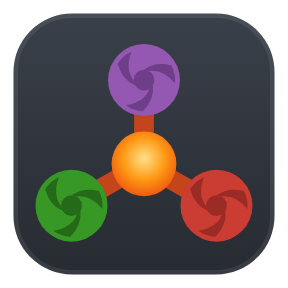
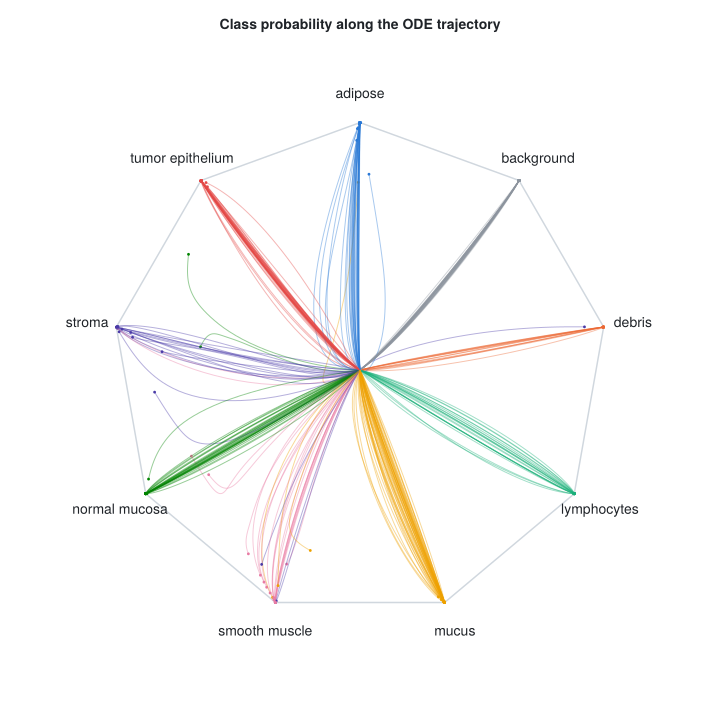
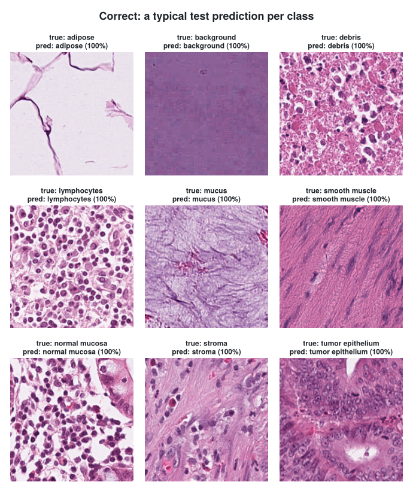
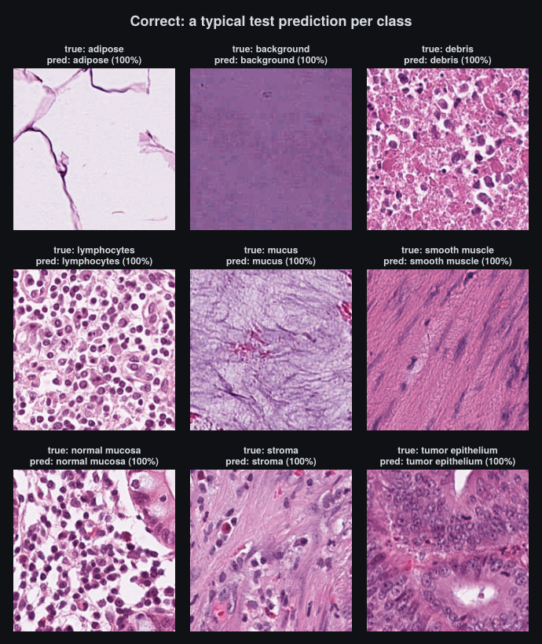
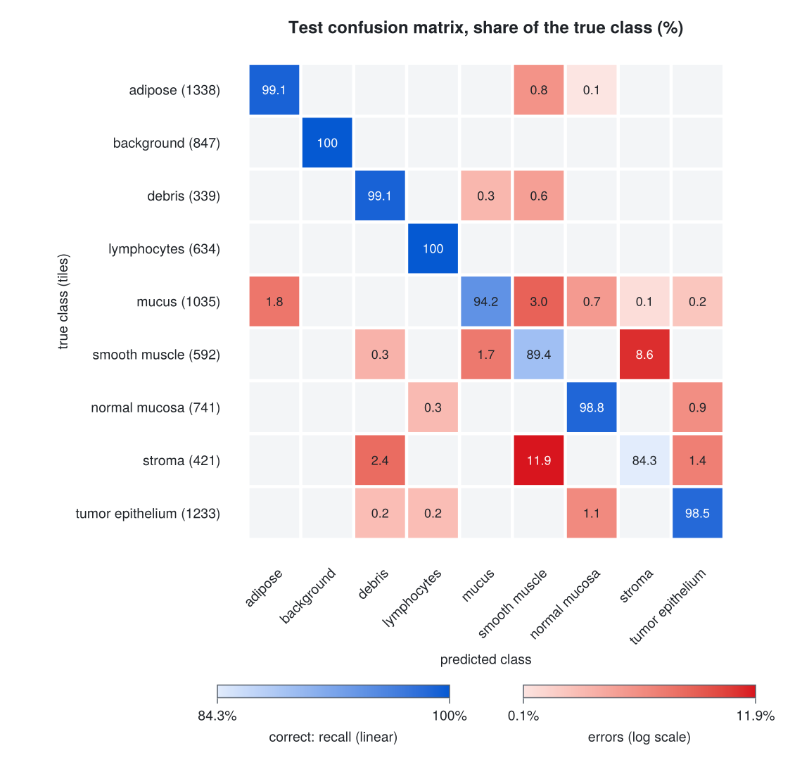
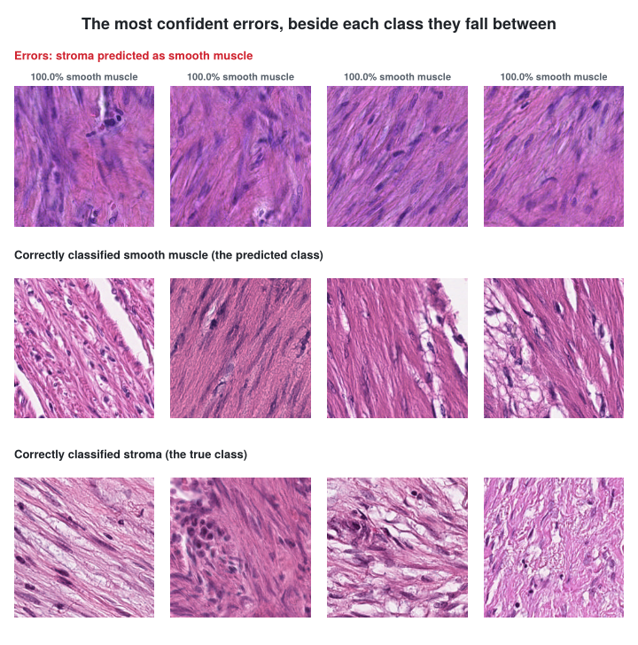
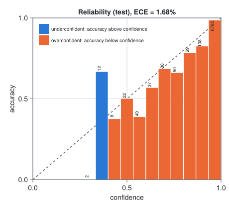
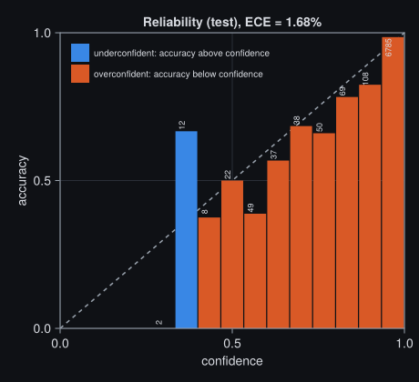

```{=html}
<div class="hero" data-base="figures/hero/" data-traj="figures/trajectories.json"></div>
<script src="figures/hero.js" defer></script>
```

Nearly a year ago, I decided to give the [Julia](https://julialang.org) programming language a shot; not even for machine learning work initially, but as a way to speed up a production service which was CPU bound. Now I know many people are thinking "[Julia has correctness issues](https://yuri.is/not-julia/)" and "dynamic typing in mah prod". In my experience the first is overstated; the second is a real trade-off, and one I've chosen to make, because the sort of things I value when deploying services and models for scientific computing are different than the sorts of things many other engineers do.

These were the parts of the language that sold me:

- A REPL workflow with [Revise.jl](https://github.com/timholy/Revise.jl), where edits to code take effect in the running session without a restart
- Julia code can be differentiated and optimized as it is written, without rewriting it in a framework's DSL, even an ODE dynamics function that calls [NonlinearSolve](https://github.com/SciML/NonlinearSolve.jl) and evaluates a cubic spline from [DataInterpolations.jl](https://github.com/SciML/DataInterpolations.jl)
- A modern runtime in the spirit of Go: garbage collection, plus [tasks and channels](https://docs.julialang.org/en/v1/manual/asynchronous-programming/) for concurrency
- Multiple dispatch, which lets separately written packages work together and lets you add specializations to other people's functions, making them faster or better integrated with your code, without opening a pull request. With agents producing more code to review than ever, I think this is a big advantage for Julia
- Fast code that stays generic and readable
- [SciML](https://sciml.ai), a mature ecosystem for differential equations, nonlinear solvers and sensitivity analysis

This post is about my journey, mostly focusing on the ML aspect, but also delving into my journey through the "production" side of things.

## Frustration with PyTorch

{width=80 fig-align="center" fig-alt="The PyTorch logo"}

We greatly accelerated our main backend service by rewriting all of the performance sensitive code in Julia. After tasting the initial success I thought to myself maybe we can do something similar with our ML stack? While PyTorch is an absolutely incredible piece of software, there were a couple of pain points that made me feel like my use case wasn't something that was going to get much support going forward:

1. [torchscript](https://docs.pytorch.org/docs/stable/jit.html) deprecation: We had come to rely on torchscript as a flexible way to deploy models. Data dependent branching and flow control were both possible, which was nice for adding postprocessing to an already trained model. It always felt much easier to just compile our models with the extra logic built in rather than try to use whatever clunky solution our serving platform offered; we loved the convenience that torchscript provided. Having triple digits worth of models tied up in a format that had received basically no support for over five years also meant we had to make a change going forward.
2. The serving ecosystem was slow to move to [`torch.export`](https://docs.pytorch.org/docs/stable/export.html): [NVIDIA Triton Server](https://github.com/triton-inference-server/server) only got [support for torch.export](https://github.com/triton-inference-server/pytorch_backend) ~3 years after torch.export was introduced.
3. [`torch.compile`](https://docs.pytorch.org/docs/stable/generated/torch.compile.html) was underwhelming for a long time: most of the performance gains seemed [locked to a specific GPU model](https://pytorch.org/get-started/pytorch-2.0/), and for several years I measured close to 0% improvement on everything I threw at it, even with [`fullgraph=True`](https://docs.pytorch.org/docs/stable/generated/torch.compile.html) guaranteeing there were no graph breaks. Many of the problems with torch.compile have since been fixed, but I was living with the same eager mode performance limitations I had been living with since I first started using PyTorch.

Together, these made me want a deployment format I could count on for years and a compiler that sped up the models I was actually training. We had already adopted Julia for our backend and were building on it extensively, so the natural next step was to see whether it could handle our ML work as well.

## One year ago: the Julia ML ecosystem

{width=96 fig-align="center" fig-alt="The Julia logo"}

While I initially found a robust array of packages for scientific computing, I could immediately tell fewer people were doing "[PyTorch](https://pytorch.org)" style ML for lack of a better term. In medical imaging it's still quite common to use CNNs as backbones are not the ceiling on most problems, believe it or not. So I surveyed the ecosystem and here is what I found:

1. [Lux.jl](https://github.com/LuxDL/Lux.jl)/[Flux.jl](https://github.com/FluxML/Flux.jl)/[Zygote.jl](https://github.com/FluxML/Zygote.jl)/[CUDA.jl](https://github.com/JuliaGPU/CUDA.jl) exist and seem to be the most comparable to what I get working with PyTorch.
2. There didn't seem to be an equivalent to [timm](https://github.com/huggingface/pytorch-image-models) where you can just load up whatever pretrained backbone you want either.
3. People were talking about something called Reactant, but I didn't really understand what it was or why I needed it

The core proposition of Zygote seems compelling: automatic differentiation at the language level, through almost any Julia code you write. But for PyTorch-style training workloads, its speed and device memory usage weren't competitive with PyTorch eager mode, so I decided to give Reactant a shot; there was a lot of talk around [Reactant.jl](https://github.com/EnzymeAD/Reactant.jl) and [Enzyme](https://enzyme.mit.edu) being the next step forward for ML in Julia.

## Reactant and Enzyme: compiling and differentiating Julia {#reactant-and-enzyme}

{width=84 fig-align="center" fig-alt="The Enzyme logo"}

Reactant compiles Julia code into an [MLIR](https://mlir.llvm.org) program, Enzyme differentiates that program at the compiler level [@moses2020enzyme], and [XLA](https://openxla.org/xla) turns the result into fused CPU/GPU/TPU kernels. [StableHLO](https://openxla.org/stablehlo) is a dialect of MLIR used by XLA, and it has a number of benefits such as promising [five years of backwards compatibility](https://github.com/openxla/stablehlo/blob/main/docs/compatibility.md). If we can compile our models to StableHLO, that means that we should have a relatively stable platform for model training and serving going forward, so I took the dive into Reactant.

With Reactant, I don't write backward passes for custom layers. Reactant traces Julia code into a small set of StableHLO operations, Enzyme's optimization passes simplify that program, and Enzyme differentiates the optimized program, so the gradient gets the same simplifications as the forward pass. In PyTorch, a layer built from loops and indexing is often slow under autograd, and making it fast can mean writing a custom `autograd.Function` with its own backward. Now when I write a new layer, I only need to consider the forward pass, and Enzyme takes care of the backward pass without giving up performance.

To be fair, none of this is exclusive to Julia. JAX users can run a function through Enzyme-JAX's optimization pipeline with the [`enzyme-ad`](https://pypi.org/project/enzyme-ad/) package's `enzyme_jax_ir` decorator, and the same package lets JAX differentiate external C++ code. Enzyme itself works on LLVM IR, so it can differentiate code from languages that compile to LLVM: C and C++ through Clang, and Rust and Fortran through their own bindings. What Reactant adds is the frontend: it traces ordinary Julia code, so an existing Julia package can become input to these compilers by being made traceable rather than rewritten against a framework's array API.

::: {.callout-note title="Bringing in existing StableHLO"}
Reactant can also call StableHLO that was produced somewhere else. `Reactant.Ops.hlo_call` takes a StableHLO module as text, for example one exported from PyTorch with torch_xla or from JAX, and inserts it into the traced program. It becomes part of the same program, so it is optimized together with the surrounding Julia code, and Enzyme can differentiate through it. I use this all the time to bring in PyTorch models I haven't ported to Julia yet.
:::

## Betting on Reactant

The next two weeks of my life were a living hell. I had no idea what I was doing with Reactant, constantly hitting tracing errors, going OoM, dealing with hour long compile times. But I persevered and kept learning from my mistakes; I had a particularly difficult problem which I needed to iterate on, but I just couldn't get PyTorch to speed it up. I was working on a problem that combined a large backbone with a NeuralODE and was using [torchdiffeq](https://github.com/rtqichen/torchdiffeq). The model took nearly a week to converge across 4x NVIDIA A6000 (Ampere). I kept going, convinced that the optimizations provided by XLA would prove decisive for the NeuralODE part.

Then the eureka moment came: effectively a 10x speedup over what I was seeing with PyTorch eager. All that time I had spent learning the basics of Reactant had paid off, and now I was in a position to quickly iterate on the model and solved the problem later that week. For the sake of transparency, it's worth noting that I have since revisited a similar workload with `torch.compile`, and got much more comparable numbers with Reactant still holding the lead, but not an "order of magnitude". Regardless, I was sold: it was time to build a full training and serving stack on top of Reactant.

## What I built

### ReactantNitro.jl {#reactantnitro}

{width=96 fig-align="center" fig-alt="The ReactantNitro.jl logo"}

[ReactantNitro.jl](https://github.com/EnzymeAD/ReactantNitro.jl) is an ML framework with a training loop designed around making Reactant easier to work with and avoiding unnecessary compiling. It has a REPL + [Revise.jl](https://github.com/timholy/Revise.jl) first workflow: you can hot reload your data processing code, sweep hyperparameters, etc. without restarting your REPL or re-compiling.

Why another framework, you say? There are two main reasons. The first is that a compiler like Reactant warrants its own framework, one that handles the [pitfalls](https://enzymead.github.io/ReactantNitro.jl/stable/pitfalls/) I ran into before I created ReactantNitro: datasets ending up in the trace and slowing compiles, programs recompiling when nothing they depend on has changed, stale programs after a code edit, device transfers at unexpected times, and device memory building up across batches.

The second is a training workflow built around Revise. In October 2025 I [wrote on Hacker News](https://news.ycombinator.com/item?id=45520854) that waiting 15+ seconds to test small changes to my PyTorch training code was rather annoying, and that "sometimes I wish we could have a training workflow similar to how Revise works." That is how I train now. I keep one Julia session open, edit the model, loss or data pipeline in my editor, and Revise patches the change into the running session. The next run picks it up without restarting Julia or reloading packages, and Nitro recompiles only the programs the edit reaches. The `@experiment` declaration makes this possible by stating which settings shape the compiled program and which can change freely. Each stage of the workflow, from setting up an experiment through training, validation, evaluation, prediction and export, is a function call at the REPL, and a Ctrl-C stops a run cleanly and hands the session back. It turns out that an interface designed for a REPL is only a few steps away from one an agent can use over MCP, so Nitro's MCP tools, covered in [Working with agents](#working-with-agents), call the same entry points.

### ReactantServer.jl {#reactantserver}

{width=96 fig-align="center" fig-alt="The ReactantServer.jl logo"}

ReactantServer grew out of one question: can we serve more models than their weights can fit on the GPU by hot swapping them in real time? That solved a real problem for us. We have a lot of models that are called infrequently, and together they were close to no longer fitting on our pod. Beyond that, it's a general serving platform for StableHLO.

[ReactantServer.jl](https://github.com/EnzymeAD/ReactantServer.jl) uses Reactant's [PJRT](https://openxla.org/xla/pjrt) interface to serve [StableHLO](https://openxla.org/stablehlo) produced by `Reactant.@compile` using the [KServe V2 protocol](https://kserve.github.io/website/latest/modelserving/data_plane/v2_protocol/). It allows you to express arbitrary pre and post processing in pure Julia without having to set up a Python environment or compile any stubs, and supports hot swapping more models than you can fit in memory at PCIe speed (typically between 10-100 ms for most CNN vision models).

### Stepping stones {#stepping-stones}

Neither of these got built overnight. Three smaller projects came first, and ReactantNitro and ReactantServer both depend on them.

{width=295 fig-align="center" fig-alt="The Luximm.jl logo"}

[Luximm.jl](https://github.com/csvance/Luximm.jl) does for Lux.jl what [timm](https://github.com/huggingface/pytorch-image-models) does for PyTorch. It ports timm's image backbones to Lux and loads their pretrained weights directly from Hugging Face Hub. It covers ResNet, SE-ResNet, BiT ResNetV2, ConvNeXt, ConvNeXt V2, VGG, ViT and CoAtNet, and parity tests check each port against the PyTorch original. The ConvNeXt V2 backbone in the walkthrough below comes from Luximm.

[gRPCClient.jl](https://github.com/JuliaIO/gRPCClient.jl) and [gRPCServer.jl](https://github.com/JuliaIO/gRPCServer.jl) give Julia a native gRPC stack, which ReactantServer uses to speak KServe V2. I rewrote gRPCClient.jl on top of libcurl's HTTP/2 support. Sébastien Celles and I wrote gRPCServer.jl.

## Reactant.jl end-to-end: Training, exporting, and serving a PathMNIST CNN and NeuralODE classifier with ReactantNitro and ReactantServer

What would a good blog post be without actually showing how you can train and serve your own models end-to-end with the Reactant stack? Yes, it's a real thing, you can do it today if you want. Since we are dealing with Julia, there must be a reason to add a NeuralODE somewhere. Honestly, I don't need one: I still find these models fascinating, especially the functions and representations they learn. Let's start with how the full stack fits together.

```{=html}
<svg class="diagram" font-family="system-ui, sans-serif" viewBox="0 0 720 412" role="img" aria-labelledby="stack-title stack-desc" xmlns="http://www.w3.org/2000/svg">
  <title id="stack-title">The Reactant ML stack, from training to serving</title>
  <desc id="stack-desc">Training runs in one Julia process: an experiment and a Lux model feed ReactantNitro, which compiles its programs through Reactant, with Enzyme differentiating the traced program, and XLA compiling for CPU, GPU, or TPU. ReactantNitro writes a model bundle through ReactantServerExport. ReactantServer serves the bundle over gRPC, and ReactantServerClient or any Triton or KServe client calls it.</desc>
  <defs>
    <marker id="st-arr" viewBox="0 0 10 10" refX="9" refY="5" markerWidth="7" markerHeight="7" orient="auto-start-reverse"><path class="head" fill="#8c959f" d="M0,0 L10,5 L0,10 z"/></marker>
    <marker id="st-arr-accent" viewBox="0 0 10 10" refX="9" refY="5" markerWidth="7" markerHeight="7" orient="auto-start-reverse"><path class="head credit" fill="#3987e5" d="M0,0 L10,5 L0,10 z"/></marker>
  </defs>

  <!-- frames -->
  <text class="note" fill="#3987e5" font-size="12" x="20" y="18">Train: one Julia process</text>
  <rect class="process" fill="none" stroke="#8c959f" stroke-width="1.5" stroke-dasharray="6 4" x="10" y="26" width="450" height="376" rx="14"/>
  <text class="note" fill="#3987e5" font-size="12" x="490" y="18">Serve: a container</text>
  <rect class="process" fill="none" stroke="#8c959f" stroke-width="1.5" stroke-dasharray="6 4" x="480" y="26" width="230" height="236" rx="14"/>

  <!-- row A: user code -->
  <rect class="box" fill="none" stroke="#8c959f" stroke-width="1.25" x="25" y="44" width="190" height="64" rx="10"/>
  <text class="code" fill="currentColor" font-family="monospace" font-size="13" font-weight="600" x="120" y="68" text-anchor="middle">@experiment + hooks</text>
  <text class="sub" fill="#8c959f" font-size="12" x="120" y="86" text-anchor="middle">your code: one struct,</text>
  <text class="sub" fill="#8c959f" font-size="12" x="120" y="100" text-anchor="middle">a handful of hooks</text>
  <rect class="box" fill="none" stroke="#8c959f" stroke-width="1.25" x="255" y="44" width="190" height="64" rx="10"/>
  <text class="title" fill="currentColor" font-size="14" font-weight="600" x="350" y="68" text-anchor="middle">Lux.jl</text>
  <text class="sub" fill="#8c959f" font-size="12" x="350" y="86" text-anchor="middle">explicit-parameter model</text>
  <text class="sub" fill="#8c959f" font-size="12" x="350" y="100" text-anchor="middle">Luximm pretrained backbone</text>
  <path class="arrow" fill="none" stroke="#8c959f" stroke-width="1.25" d="M120,108 V130" marker-end="url(#st-arr)"/>
  <path class="arrow" fill="none" stroke="#8c959f" stroke-width="1.25" d="M350,108 V130" marker-end="url(#st-arr)"/>

  <!-- row B: ReactantNitro -->
  <rect class="box accent" fill="none" stroke="#3987e5" stroke-width="1.25" x="25" y="134" width="420" height="64" rx="10"/>
  <text class="title" fill="currentColor" font-size="14" font-weight="600" x="235" y="158" text-anchor="middle">ReactantNitro.jl</text>
  <text class="sub" fill="#8c959f" font-size="12" x="235" y="176" text-anchor="middle">compiles the gradient, optimizer, and eval programs</text>
  <text class="sub" fill="#8c959f" font-size="12" x="235" y="190" text-anchor="middle">data pipeline · checkpoints · export</text>
  <path class="arrow" fill="none" stroke="#8c959f" stroke-width="1.25" d="M120,198 V220" marker-end="url(#st-arr)"/>
  <path class="arrow" fill="none" stroke="#8c959f" stroke-width="1.25" d="M350,198 V220" marker-end="url(#st-arr)"/>

  <!-- row C: Reactant and Enzyme -->
  <rect class="box" fill="none" stroke="#8c959f" stroke-width="1.25" x="25" y="224" width="190" height="64" rx="10"/>
  <text class="title" fill="currentColor" font-size="14" font-weight="600" x="120" y="248" text-anchor="middle">Reactant.jl</text>
  <text class="sub" fill="#8c959f" font-size="12" x="120" y="266" text-anchor="middle">traces Julia code to</text>
  <text class="sub" fill="#8c959f" font-size="12" x="120" y="280" text-anchor="middle">MLIR (StableHLO)</text>
  <rect class="box" fill="none" stroke="#8c959f" stroke-width="1.25" x="255" y="224" width="190" height="64" rx="10"/>
  <text class="title" fill="currentColor" font-size="14" font-weight="600" x="350" y="248" text-anchor="middle">Enzyme</text>
  <text class="sub" fill="#8c959f" font-size="12" x="350" y="266" text-anchor="middle">reverse-mode AD on</text>
  <text class="sub" fill="#8c959f" font-size="12" x="350" y="280" text-anchor="middle">the traced program</text>
  <path class="arrow" fill="none" stroke="#8c959f" stroke-width="1.25" d="M215,256 H251" marker-end="url(#st-arr)"/>
  <path class="arrow" fill="none" stroke="#8c959f" stroke-width="1.25" d="M120,288 V310" marker-end="url(#st-arr)"/>
  <path class="arrow" fill="none" stroke="#8c959f" stroke-width="1.25" d="M350,288 V310" marker-end="url(#st-arr)"/>

  <!-- row D: XLA -->
  <rect class="box" fill="none" stroke="#8c959f" stroke-width="1.25" x="25" y="314" width="420" height="64" rx="10"/>
  <text class="title" fill="currentColor" font-size="14" font-weight="600" x="235" y="338" text-anchor="middle">XLA, through PJRT</text>
  <text class="sub" fill="#8c959f" font-size="12" x="235" y="356" text-anchor="middle">optimizes and compiles for CPU, GPU, or TPU: any XLA backend</text>
  <text class="sub" fill="#8c959f" font-size="12" x="235" y="370" text-anchor="middle">C++ libraries; no Python anywhere</text>

  <!-- export: Nitro to bundle -->
  <path class="arrow credit" fill="none" stroke="#3987e5" stroke-width="1.25" stroke-dasharray="4 4" d="M445,166 H468 V76 H491" marker-end="url(#st-arr-accent)"/>

  <!-- right column -->
  <rect class="box" fill="none" stroke="#8c959f" stroke-width="1.25" x="495" y="44" width="200" height="64" rx="10"/>
  <text class="title" fill="currentColor" font-size="14" font-weight="600" x="595" y="68" text-anchor="middle">model bundle</text>
  <text class="sub" fill="#8c959f" font-size="12" x="595" y="86" text-anchor="middle">written by ReactantServerExport</text>
  <text class="sub" fill="#8c959f" font-size="12" x="595" y="100" text-anchor="middle">StableHLO, weights, IO spec</text>
  <path class="arrow" fill="none" stroke="#8c959f" stroke-width="1.25" d="M595,108 V176" marker-end="url(#st-arr)"/>
  <text class="note" fill="#3987e5" font-size="12" x="603" y="146">load</text>

  <rect class="box accent" fill="none" stroke="#3987e5" stroke-width="1.25" x="495" y="180" width="200" height="64" rx="10"/>
  <text class="title" fill="currentColor" font-size="14" font-weight="600" x="595" y="204" text-anchor="middle">ReactantServer.jl</text>
  <text class="sub" fill="#8c959f" font-size="12" x="595" y="222" text-anchor="middle">KServe V2 over gRPC (:8001)</text>
  <text class="sub" fill="#8c959f" font-size="12" x="595" y="236" text-anchor="middle">compiled ahead of time, CUDA</text>

  <path class="arrow" fill="none" stroke="#8c959f" stroke-width="1.25" d="M595,248 V310" marker-start="url(#st-arr)" marker-end="url(#st-arr)"/>
  <text class="note" fill="#3987e5" font-size="12" x="603" y="295">gRPC</text>

  <rect class="box" fill="none" stroke="#8c959f" stroke-width="1.25" x="495" y="314" width="200" height="64" rx="10"/>
  <text class="code" fill="currentColor" font-family="monospace" font-size="13" font-weight="600" x="595" y="338" text-anchor="middle">ReactantServerClient.jl</text>
  <text class="sub" fill="#8c959f" font-size="12" x="595" y="356" text-anchor="middle">or any Triton or KServe</text>
  <text class="sub" fill="#8c959f" font-size="12" x="595" y="370" text-anchor="middle">gRPC client</text>
</svg>
```

## The problem: PathMNIST

We are pointing the stack at the PathMNIST dataset rather than something completely trivial like MNIST. The model learns to predict between 9 tissue classes over a set of 224x224 images; this is distantly related to the sorts of problems I deal with at work, but basically none of those sorts of problems have had anything close to an "ImageNet" moment where a high quality dataset is publicly available. So hopefully this is a bit more interesting than a pure "toy" dataset. Open to suggestions here!

## Setting up the environment

```bash
juliaup add 1.13.1
git clone https://github.com/csvance/PathMNISTReactant.jl
cd PathMNISTReactant.jl
julia +1.13.1 --project=.
```

```julia
using Pkg
Pkg.instantiate()
```

## ReactantNitro.jl: Declaring the `@experiment`

ReactantNitro uses a small experiment macro to ensure things are wired up correctly and Reactant's tracer doesn't trace over things it shouldn't, which can be a source of slow compiles. We declare an `@experiment` for PathMNIST. All of ReactantNitro's hooks dispatch on this type.

Each field's type says how it reaches the compiled program. A `GraphConst` field is baked into the program as a constant, so changing it recompiles; it is for values that change the graph, such as the number of classes or a layer width. A `Device` field is passed to the program as a traced input, so it can be swept or scheduled without recompiling; `kinetic_weight` is one. Unmarked fields stay on the host and never reach the compiled program, which covers everything else, such as the data paths, the batch size and the learning rate.

::: {.callout-note collapse="true" title="The full `@experiment`"}

```{julia}

```

:::

## The model

We create a CNN backbone (provided by Luximm.jl) that maps an image to a pooled feature vector. After a LayerNorm, a linear layer projects that vector into the first 32 dimensions of the NeuralODE's state; the other nine, one per class, always start at zero. The state then evolves over 100 steps of RK4 integration, and the nine class dimensions at the end are the logits. There is no classifier layer after the ODE, so every prediction starts out uniform and only the flow can carry it to a class, an idea that builds on augmented NeuralODEs [@chen2018neuralode; @dupont2019anode].

Because the logits are part of the ODE's state, the prediction can be read at any point along the trajectory: $p(t) = \operatorname{softmax}(z(t))$. Here is what the trained model does with 256 test tiles. A helper script in the companion repo compiles one extra program that records $p(t)$ every two RK4 steps, then draws the flow. It places the nine classes on the corners of a regular nonagon and plots each test tile at $\sum_k p_k(t)\,\mathrm{corner}_k$. Every trajectory starts at the center, the uniform prediction at $t = 0$, and the flow carries it out to a class:

```{=html}
<div class="traj-player" data-src="figures/trajectories.json">
  <noscript></noscript>
</div>
<script src="figures/trajectory-player.js" defer></script>
```

Press play or drag the slider to move through the integration. Tap a class to isolate its tiles, or a tile to see all nine of its probabilities at the current t.

::: {.callout-note collapse="true" title="`rk4` and `node_head`: RK4 integration and the NeuralODE head"}

```{julia}


```

:::

::: {.callout-note collapse="true" title="`build_model`: the backbone, the head, and pretrained weights"}

```{julia}

```

:::

## The data pipeline

Only the training split is augmented. Validation and test tiles go through exactly as they are stored, so every evaluation, and every request to the served model later on, sees the same pixels.

::: {.callout-note collapse="true" title="Augmentations"}

| Augmentation | Range / distribution | Justification |
|---|---|---|
| Rotation by multiples of 90° (`aug_rot90`) | $k \in \{0, 1, 2, 3\}$, uniform | Tissue has no canonical orientation; an index permutation, so no interpolation and essentially free |
| Mirror (`aug_flip`) | $\mathrm{Bernoulli}(0.5)$ | With rotation, covers all 8 symmetries of the square uniformly; also an index permutation |

:::

::: {.callout-note collapse="true" title="How Nitro drives the loader: PyTorch `DataLoader` vs ReactantNitro"}

ReactantNitro supports parallel dataloaders, but there are some key differences from how that works in PyTorch.

| | PyTorch `DataLoader` | ReactantNitro + MLUtils `DataLoader` |
|---|---|---|
| Unit of parallelism | Worker processes (`num_workers`) | Tasks on the default thread pool, inside the training process |
| Dataset in workers | A copy per worker process | One object, one memory map, shared |
| Batch hand-off | Tensors in shared memory, handles through queues | Same address space; batches passed directly |
| Throughput knob | `num_workers` | `julia -t N,1` (N tasks) |
| Read-ahead | `prefetch_factor` batches per worker (default 2) | `host_batches = 2 × N` on the host, `device_batches = 1` on the device |
| Host to device | Your loop: `pin_memory`, `.to(device, non_blocking=True)` | One transfer task, only the fields the hooks declare |
| Worker lifetime | Restarted each epoch unless `persistent_workers=True` | Tasks, cheap to start every epoch |
| Short final batch | `drop_last`, one setting for the loader | Train must drop it (fixed program shape); eval keeps it, padded by Nitro |
| Memory management | Per-process; workers never pause the training process | Shared GC; data-path allocation can pause training |

:::

## Training with ReactantNitro

The remaining hooks are `forward`, `loss` and `train_metrics`. `forward` is the program Nitro compiles for both training and inference, and `loss` is the scalar Enzyme differentiates: cross-entropy, plus the kinetic-energy penalty of @finlay2020rnode when `kinetic_weight` is turned up. `train_metrics` runs inside the gradient program, so the dynamics are logged every step at no extra cost.

::: {.callout-note collapse="true" title="`forward`, `loss` and `train_metrics`: the training hooks"}

```{julia}

```

:::

`metrics` runs on the host after each validation batch. Each entry is `value => mode`: `value => n` is added up over the split and divided once by the summed `n`, and `value => :sum` is only summed, which is how the confusion matrix and the calibration bins travel. A mode can cover a whole group of values, so the three calibration sums travel together under one name. `finalize_metrics` turns them into the numbers that matter once per epoch: macro accuracy (the mean of per-class recall, the main metric here, since the test set's classes are not balanced), plain accuracy, the expected calibration error over 15 confidence bins, and the mean motion and kinetic energy of the ODE, so validation also shows whether the dynamics are doing anything.

::: {.callout-note collapse="true" title="`metrics` and `finalize_metrics`: macro accuracy, ECE, and the ODE's motion"}

```{julia}

```

:::

::: {.callout-note collapse="true" title="The optimizer and learning-rate schedule"}

The optimizer is RAdam, Nitro's default rule, with decoupled weight decay of $10^{-4}$ on the weights, except the NeuralODE's vector field, which gets its own parameter group with no decay, since decay would keep pulling the dynamics back toward zero. Biases and normalization scales and shifts are never decayed: a `no_decay` rule excludes every parameter with at most one dimension larger than 1, which covers them however many singleton dimensions Lux stores them with. The learning rate follows a one-cycle schedule [@smith2019superconvergence] from [ParameterSchedulers.jl](https://github.com/FluxML/ParameterSchedulers.jl), peaking at $10^{-3}$ at 30% of the run. A schedule key binds to an optimizer rule field, here `eta`, the learning rate, or to a `Device` field of the experiment, so `kinetic_weight` could be scheduled the same way without a recompile. None of these values are part of the compiled program, so changing them does not trigger a recompile. The checkpointer keeps the epochs with the best validation macro accuracy.

```{julia}
using ParameterSchedulers: OneCycle


```


:::

The batch fields (`img`, `label`) are keyword arguments, so each hook declares exactly what it reads, and Nitro only transfers those fields to the device. To train, create a handle and call `train!`:

```{julia}
using PathMNISTReactant, ReactantNitro

nitro = Nitro(PathMNIST(); run_dir = "runs/pathmnist", restore_best = true)
train!(nitro)    # ends by loading the best checkpoint by validation macro accuracy
```

Five epochs took 31 minutes on one RTX A6000, compilation included. The first loss is 2.197, which is $\ln 9$, because the logits and the dynamics both start at zero and the model initially predicts all nine classes equally. After training, displaying the handle prints a summary of the run: the final epoch and step, the checkpoint it restored, the last validation metrics, what each schedule and setting bound to and where it came from, and the settings each parameter group ended up with:

::: {.callout-note collapse="true" title="Output of `nitro` after training: the run summary"}

```{julia}
nitro
```

```
Nitro for PathMNIST
┌───────────────────────────────────────────────────────────────────────────────────────────────────────────────────────────┐
│ phase          Done (completed)                                                                                           │
│ epoch          5 / 5                                                                                                      │
│ step           14060 / 14060                                                                                              │
│ params         27,912,393 in 2 groups                                                                                     │
│ batch_size     16                                                                                                         │
│ devices        1  (no mesh)                                                                                               │
│ elapsed        30m 40s  (this `train!` call)                                                                              │
│ weights        trained here, then restored to the best checkpoint, epoch 5 (`restore_best`)                               │
│ run_dir        runs/pathmnist   run FrMe8zap                                                                              │
│ seed           0   accum 2                                                                                                │
├───────────────────────────────────────────────────────────────────────────────────────────────────────────────────────────┤
│ checkpoint                                                                                                                │
├───────────────────────────────────────────────────────────────────────────────────────────────────────────────────────────┤
│ selected       epoch 5, macro_acc 0.9969854799235072, run FrMe8zap  (the handle holds these weights)                      │
│ path           runs/pathmnist/epoch-0005-step-14060-macro_acc=0.996985.jld2                                               │
├───────────────────────────────────────────────────────────────────────────────────────────────────────────────────────────┤
│ metrics  (validation, epoch 5)                                                                                            │
├───────────────────────────────────────────────────────────────────────────────────────────────────────────────────────────┤
│ val_loss       0.013404024f0                                                                                              │
│ macro_acc      0.9969854799235072                                                                                         │
│ acc            0.997001199520192                                                                                          │
│ ece            0.0013020081383759668                                                                                      │
│ motion         0.28475937f0                                                                                               │
│ kinetic        462.94992f0                                                                                                │
├───────────────────────────────────────────────────────────────────────────────────────────────────────────────────────────┤
│ data                                                                                                                      │
├───────────────────────────────────────────────────────────────────────────────────────────────────────────────────────────┤
│ split          resolved                                                                                                   │
│ train          5624 batches; prefetch: 16 workers, 1 on device, 32 on host                                                │
│ val            626 batches; prefetch: 16 workers, 1 on device, 32 on host                                                 │
│ test           449 batches; prefetch: 16 workers, 1 on device, 32 on host                                                 │
├───────────────────────────────────────────────────────────────────────────────────────────────────────────────────────────┤
│ bindings                                                                                                                  │
├───────────────────────────────────────────────────────────────────────────────────────────────────────────────────────────┤
│ binding        what                                                                                   source              │
│ gradient clip  none, threshold 0; a run with no clipping                                              [framework default] │
│ eta            optimizer field, all groups, per-group ratio applied                                   [schedules(e)]      │
├───────────────────────────────────────────────────────────────────────────────────────────────────────────────────────────┤
│ parameter groups (G = 2)                                                                                                  │
├───────────────────────────────────────────────────────────────────────────────────────────────────────────────────────────┤
│ group          settings                                                                               params              │
│ :default       eta 0.001 (x1.0), lambda 0.0001 toward zero, RAdam                                     27,891,104          │
│ :node          eta 0.001 (x1.0), lambda 0.0 toward zero, RAdam                                        21,289              │
└───────────────────────────────────────────────────────────────────────────────────────────────────────────────────────────┘
  ask it for more with `history`, `experiment`, `parameters`, `states`, `logger_info`
```

:::

::: {.callout-note collapse="true" title="Output of `history(nitro)`: the per-epoch series"}

Validation improves every epoch, most of all once the learning rate is past its peak and annealing, and the `motion` and `kinetic` columns show the ODE's dynamics growing from zero:

```{julia}
history(nitro)
```

```
history of PathMNIST  (runs/pathmnist)
┌──────────────────────────────────────────────────────────────────────────────────┐
│ epoch   step     loss  macro_acc  val_loss     acc       ece  motion  kinetic    │
├──────────────────────────────────────────────────────────────────────────────────┤
│     1   2812  0.52093     0.9036   0.32873  0.9030  0.023010  0.3244    105.0    │
│     2   5624  0.16438     0.9435   0.18530  0.9425  0.010009  0.2646    277.5    │
│     3   8436  0.10003     0.9833   0.05752  0.9828  0.002654  0.2838    452.0    │
│     4  11248  0.04580     0.9909   0.02962  0.9911  0.002893  0.2892    477.2    │
│     5  14060  0.01317     0.9970   0.01340  0.9970  0.001302  0.2848    462.9  * │
└──────────────────────────────────────────────────────────────────────────────────┘
  * best macro_acc (max), the checkpointer's metric
```

:::

## Evaluating on the test set

Validation comes from the same source as training (NCT-CRC-HE-100K), so it is close to saturated. The test set is CRC-VAL-HE-7K, a separate cohort of patients, so it is the better measure of how well the model generalizes. The same handle evaluates it with the programs it already compiled:

```{julia}
evaluate(nitro; split = :test)
```

```
(val_loss = 0.13172214f0, macro_acc = 0.9592741093176953, acc = 0.9676880222841225, ece = 0.016802187816014197, motion = 0.29917392f0, kinetic = 452.36755f0)
```

| Test metric | Value |
|---|---:|
| Macro accuracy | 95.93% |
| Accuracy | 96.77% |
| Expected calibration error (15 bins) | 1.68% |
| Loss | 0.132 |

For comparison with published results on the same test set: Kather et al., who built the dataset, reported 94.3% accuracy with a VGG19 [@kather2019]. In the MedMNIST+ benchmark at 224 px, the best models reach about 96% accuracy, with 96.07% for SAM ViT-B/16 trained end to end and 96.14% for a linear probe on DINO ViT-B/16 [@doerrich2025medmnistplus]. Large pathology foundation models land in the same place: UNI 2 and Virchow 2 both reach 95.3% balanced accuracy (the same measure as macro accuracy here) and 96.0% and 96.7% accuracy, and Shazam, which combines several of them, reaches 96.0% and 97.2% [@lei2025shazam]. This model's 95.93% macro accuracy and 96.77% accuracy are within that range.

I suspect part of that ceiling comes from the dataset itself. Ignatov and Malivenko found inappropriate color normalization, JPEG artifacts that differ between classes, and corrupted tiles in NCT-CRC-HE-100K, and a classifier that only sees color histograms reached over 82% accuracy on it [@ignatov2024nctcrche]. Some of what a model learns from the training set is therefore not tissue structure, and it may not carry over to a test cohort that was prepared differently.

::: {.light-content}

:::

::: {.dark-content}

:::

Per class, seven of the nine tissues are above 94% recall. Smooth muscle and stroma are the outliers, and they are mostly mistaken for each other. The model misclassifies 232 of the 7,180 test tiles. In the confusion matrix below, each row is a true class, and each cell is the share of that class's tiles predicted as the column's class. The buttons switch it to raw counts, or to shares of the predicted class.

```{=html}
<div class="cm-player" data-src="figures/confusion.json">
  <noscript></noscript>
</div>
<script src="figures/confusion-matrix.js" defer></script>
```

Stroma and smooth muscle are both pink, fibrous tissue made of elongated, spindle-shaped cells, and the model is often confident when it confuses them. 51 of the 232 errors have a confidence above 99%, and all of the 12 most confident errors are stroma tiles predicted as smooth muscle. The four most confident are shown below beside correctly classified tiles of both classes, and they look more like the smooth muscle examples than the stroma ones:

::: {.light-content}

:::

::: {.dark-content}

:::

The calibration error is small overall, and the reliability diagram shows where it comes from. 6,785 of the 7,180 test tiles land in the top bin, where confidence and accuracy agree; in all but one of the bins below it the model is overconfident, but each holds at most about a hundred tiles (the count is on each bar).

::: {.light-content}
{width=60%}
:::

::: {.dark-content}
{width=60%}
:::

::: {.callout-note collapse="true" title="Ablations: what didn't help"}
I tried a few things on top of this run, all on the same 5-epoch schedule unless noted, and none of them clearly beat it. Training the same configuration with different seeds moves test macro accuracy by about 0.6 points, so anything smaller than that is noise.

- **A wavelet texture branch:** five Haar levels of subband energies, concatenated to the pooled backbone features. On RGB it changed nothing (two seeds). On haematoxylin and eosin densities, after colour deconvolution, it was ahead on two seeds and behind on the third: +0.2 points on average.
- **HSV colour jitter** (hue ±0.05 of a turn, saturation ±30%, value ±20%): about 1.5 points worse on test, at 5 and at 10 epochs. It also needed gradient clipping; without it, training diverged during the warm-up.
- **Label smoothing 0.1** on top of the jitter: no better, and much worse calibrated (ECE around 8%).
- **10 epochs**, or **a gentler backbone learning rate**: both within noise.

The backbone may also be part of why the texture ideas added nothing. ConvNeXt V2 is pretrained as a fully convolutional masked autoencoder (FCMAE) before its ImageNet fine-tuning [@woo2023convnextv2]: it learns by reconstructing masked regions from their surroundings, which might make it particularly well suited to local features and textures already. SAM's image encoder, the best end-to-end model in MedMNIST+, was also initialized from masked-autoencoder pretraining.

Given how close the published results above are to this model, I suspect we are near the limit of what this test set allows. The code for these runs is in the companion repo at commit [7684532](https://github.com/csvance/PathMNISTReactant.jl/tree/7684532), and each run's settings and numbers are in `blog/sweep_results.jsonl`.
:::

## Exporting the model

Export turns the trained model into a bundle ReactantServer can load: StableHLO for each batch size, the weights, and a manifest describing the tensors on the wire. Two hooks define the inputs a client sends and the outputs it gets back. The model already converts `UInt8` pixels to normalized `Float32` inside its own program, so the wire tensor is the same `img` batch field `forward` reads, and of everything `forward` returns, only the logits ship; the kinetic energy and motion stay in training.

```{julia}

```

The export itself is one call on the trained handle. `ReactantServerExport` is a separate package that loads ReactantNitro's export extension, so a training environment that doesn't export never has to load it. Export is a CPU trace and does not reuse the training compile cache; for both batch sizes it took about seven minutes.

```{julia}
using ReactantServerExport

export_model(nitro, ReactantServerBundle(); dir = "bundles", name = "pathmnist_node",
    batch_sizes = [1, 16])
```

```
bundles/pathmnist_node/
├── manifest.yaml           1.5 KB
├── model.b1.mlir            50 KB   StableHLO, batch 1
├── model.b16.mlir           50 KB   StableHLO, batch 16
└── weights.safetensors     107 MB
```

The manifest describes the tensors the server expects and returns, in Julia's axis order with the batch axis last. It also carries provenance: the full experiment configuration, the ReactantNitro and Reactant versions, and the checkpoint the weights came from.

```yaml
executable_inputs:
  - name: "img"
    dtype: "u8"
    shape: "acdn"
    dims: { a: 224, c: 224, d: 3 }
executable_outputs:
  - name: "logits"
    dtype: "f32"
    shape: "an"
    dims: { a: 9 }
batching:
  compiled_batch_sizes: [1, 16]
```

## Serving with ReactantServer

ReactantServer serves every bundle in a model repository over the KServe V2 gRPC protocol. The image is pinned by digest, so the command runs exactly the server described here even after newer images are published. Mount the repository read-write, since the server stores each bundle's compiled executables beside it so later starts skip compilation:

::: {.callout-note collapse="true" title="Prerequisites"}
[podman](https://podman.io), the [NVIDIA Container Toolkit](https://docs.nvidia.com/datacenter/cloud-native/container-toolkit/latest/index.html), and a CDI spec so podman can see the GPU. Rootless podman works.

```bash
sudo nvidia-ctk cdi generate --output=/etc/cdi/nvidia.yaml
```
:::

```bash
podman run --rm --device nvidia.com/gpu=0 \
  -v ./bundles:/var/lib/reactantserver/models:Z \
  -p 8001:8001 -p 8002:8002 \
  ghcr.io/enzymead/reactantserver@sha256:ba640d6a1b048ae9bc728a47ade971318d37fa8cfbcc6e2539e5d096b07cb0d5

curl -s localhost:8002/readyz                # 200 once the model is compiled and serving
```

## Calling the server

The client only depends on ReactantServerClient, which doesn't pull in Reactant or XLA, so it can run on a machine without a GPU. It reads the test split from the same memory-mapped `.u8` files used for training.

For streaming a whole dataset, ReactantServerClient stages requests in a pool of buffers it allocates once and reuses, so sending the test set doesn't allocate a new array per request or put pressure on the garbage collector. Several requests are in flight at once, and when the server is on the same host the client can send the data through shared memory instead.

::: {.callout-note collapse="true" title="Streaming the test set through the staging pool"}

```{julia}
using ReactantServerClient, Mmap




images, labels = load_split("data/pathmnist_224", "test")
logits = zeros(Float32, 9, length(labels))

kserve_init()
model = KServeModel("grpc://127.0.0.1:8001", "pathmnist_node"; max_batch_size = 16)
infer_async(model, TileIO(images, logits))
pred = [argmax(z) for z in eachcol(logits)]
count(pred .== labels) / length(labels)
```

:::

On the same RTX A6000, the full test set ran at about 1,030 tiles per second in batches of 16, and a single tile took 7.8 ms at the median (about 90 ms at the 99th percentile, consistently across runs). For comparison, a training step in the [benchmark below](#training-speed-against-pytorch) takes 88.5 ms for 32 tiles, about 360 tiles per second. Serving is about 2.9 times faster than training, since it runs only the forward pass, without the backward pass or the optimizer update. The served model agrees with the in-process one:

| | In-process (`evaluate`) | Served |
|---|---:|---:|
| Accuracy | 96.77% | 96.77% |
| Macro accuracy | 95.93% | 95.93% |
| Predictions that differ | | 0 of 7,180 |
| Largest probability difference | | 0.00044 |

The small probability differences come from the server compiling and autotuning its own kernels. And because ReactantServer speaks the standard KServe V2 protocol, the client does not have to be Julia: Triton's [`tritonclient`](https://github.com/triton-inference-server/client) or any gRPC client that implements the spec works the same way.

## Training speed against PyTorch

The switch started with a 10x speedup over PyTorch eager on a CNN into a NeuralODE. A year later, I ran the comparison again on this post's model and on the NeuralODE by itself, against both PyTorch eager and `torch.compile`. It only covers these two workloads: enough to show that Reactant's performance is good and that compile time is not a deal breaker.

The biggest surprise for me was `torch.compile`. Coming back to it after a year, it now works smoothly on these workloads. Much of the 10x I originally saw was against PyTorch eager, and a hand-written RK4 loop compiled with `mode="reduce-overhead"`, which captures each step in CUDA graphs, closes most of that gap. I couldn't get torchdiffeq itself to compile, even with its RK4 solver, so both stacks here use a hand-written RK4.

Both stacks use the same weights (timm's ConvNeXt V2 Tiny and Luximm's port of it), batch size 16 with 2 accumulation steps, 224×224 inputs and TF32, on one RTX A6000. "Step" is the steady-state time for one training step, and the last column is the first step, including compilation.

| Workload | Stack | Step | First step (compile included) |
|---|---|---:|---:|
| CNN to NeuralODE (this post's model) | Julia, Reactant default | **88.5 ms** | 318 s |
| | PyTorch `max-autotune` (fastest) | 100.3 ms | 1,420 s |
| | PyTorch `reduce-overhead` | 107.2 ms | 147 s |
| | PyTorch eager | 391.6 ms | **6 s** |
| NeuralODE alone (MLP, RK4, 100 steps) | Julia, Reactant default | **10.8 ms** | 99 s |
| | PyTorch `reduce-overhead` (fastest) | 16.1 ms | 6 s |
| | PyTorch eager | 127.1 ms | **0.4 s** |

Reactant, through XLA, is ahead of `torch.compile` (Inductor) on both workloads: 1.13x faster than its fastest mode on the full CNN to NeuralODE model, and 1.5x on the NeuralODE alone. Against PyTorch eager the gap is 4.4x and 12x. Compilation takes a few minutes, and ReactantNitro keeps the compiled programs for as long as the Julia process runs, so later runs reuse them unless the graph changes. PyTorch's fastest mode on the full model, `max-autotune`, compiled for 24 minutes. On the NeuralODE alone, though, `torch.compile` is much quicker than Reactant: 6 s against 99 s.

## Working with agents

::: {style="text-align: center"}
{width=96 fig-alt="The Revise.jl logo"} {width=96 fig-alt="The Kaimon.jl logo"}
:::

I keep one long-lived Julia session open with [Revise.jl](https://github.com/timholy/Revise.jl). Changes that don't touch the compiled graph, such as the learning rate, schedules, augmentation, data loading or logging, take effect immediately with no restart and no recompile. A run already in progress keeps running the code it started with, so edits take effect from the next run. This matters even more for agents, which make many small edits and check each one.

Day to day, I don't write much code by hand anymore. Coding agents write most of it, while I review the results and make the decisions. [Kaimon.jl](https://github.com/kahliburke/Kaimon.jl), by [Kahli Burke](https://slate-portfolio.pages.dev/), is what makes that practical in Julia. It runs Julia sessions and exposes them to an agent over MCP, so the agent evaluates code, runs tests and searches the codebase in a warm session, instead of starting a new Julia process for every command and paying for package loading and compilation each time.

ReactantNitro and ReactantServer both build on this. Each has a package extension that loads when KaimonGate, the part of Kaimon that runs inside the Julia session, is present, and registers MCP tools for its own work. ReactantNitro's tools set up an experiment; start, monitor and stop training; and validate, evaluate, predict and export (`nitro_setup`, `nitro_train`, `nitro_status`, `nitro_stop`, `nitro_validate`, `nitro_evaluate`, `nitro_predict`, `nitro_export`). ReactantServer's tools start and stop a server, report its status and list the models it serves (`rserver_start`, `rserver_status`, `rserver_models`, `rserver_stop`). An agent can train a model, export it and serve it from the same session it uses to edit the code. Training runs in the background and the tool returns a run ID straight away, so the agent checks on the run instead of waiting for it.

Any Julia package can give agents tools the same way. It declares KaimonGate as a weak dependency and adds a package extension, and Julia compiles and loads that extension automatically whenever KaimonGate is loaded in the same session, and never otherwise, so the package itself takes on no new dependency. Inside the extension, a tool is an ordinary Julia function: KaimonGate reads its arguments and keyword arguments to build the MCP schema, and uses its docstring as the tool's description.

::: {.callout-note collapse="true" title="`ext/MyPackageKaimonGateExt.jl`: one tool"}

```{julia}
module MyPackageKaimonGateExt

using MyPackage, KaimonGate

"""
    mypackage_status(; verbose = false) -> String

Report what MyPackage is doing in this session.
"""
mypackage_status(; verbose::Bool = false) = MyPackage.status_report(; verbose)

# Register with the session's running gate; tools merge by name with other packages' tools.
register() = KaimonGate.serve(tools = [KaimonGate.GateTool("mypackage_status", mypackage_status)])

end
```

:::

The model in this post was built this way. An agent ran the training runs, the hyperparameter sweep behind the ablations, and the scripts that produce the figures, through Kaimon.

## What's next

{width=88 fig-align="center" fig-alt="The SciML logo"}

I want to keep writing one language and use it to target many compilers and accelerators. Reactant compiles ordinary Julia to StableHLO, which XLA optimizes for CPU, GPU or TPU and [Enzyme-JAX](https://github.com/EnzymeAD/Enzyme-JAX) differentiates. I'm also looking forward to the seemingly never-ending stream of optimization work on Enzyme-JAX, and to seeing the Reactant.jl ecosystem mature.

I'd also like to see the SciML ecosystem follow, so that the existing [OrdinaryDiffEq](https://github.com/SciML/OrdinaryDiffEq.jl) and [SciMLSensitivity](https://github.com/SciML/SciMLSensitivity.jl) packages can be called inside a Reactant-compiled program, the way [Diffrax](https://github.com/patrick-kidger/diffrax) works inside JAX. That would bring their adaptive and stiff solvers and choice of adjoint methods into compiled programs, instead of the hand-written RK4 I use today. It isn't here yet, but work is moving toward it. A [draft pull request](https://github.com/SciML/OrdinaryDiffEq.jl/pull/4436) makes OrdinaryDiffEq's `solve` trace under Reactant's `@compile` for explicit solvers, with the remaining pieces, such as `saveat`, callbacks and implicit solvers, tracked in [an issue](https://github.com/SciML/OrdinaryDiffEq.jl/issues/4657). SciMLSensitivity can already compile the vector-Jacobian products inside its adjoints with `ReactantVJP`.

## Wrapping up

A year ago I started using Julia to speed up a CPU-bound service. Today I train, export and serve models with it, and the bet solved each of the problems that pushed me away from PyTorch. Every PyTorch model we had converted to StableHLO, including object detection models, several BERT models and many other computer vision models. Pre and post processing is ordinary Julia code compiled into the same program as the model, and ReactantServer serves those programs directly. We have been testing it for months, and it is part of an upcoming regulated release. On the workloads I measured, Reactant trains faster than `torch.compile`, and I haven't trained a PyTorch model in half a year. The walkthrough in this post covers the whole path on a real dataset: a ConvNeXt V2 backbone with a NeuralODE head, trained with ReactantNitro to results in line with published models on the same test set, exported to StableHLO, and served by ReactantServer with the same predictions it makes in process.

Getting here took more than Reactant. I spent a significant amount of time getting the gRPC client and server packages stable enough for production use, ported timm's backbones to Lux, and built my own ML framework and serving platform. Startup is still slower than PyTorch eager. Compiling takes minutes, while eager mode in my experience takes up to 30 to 45 seconds to start training. Once training is running, `torch.compile` has closed most of the speed gap on these workloads.

The day-to-day workflow has made that effort worth it. Agents train, export and serve models through MCP, and they do well with a REPL and Revise driven workflow, where each small edit can be checked in a session that is already running.

Using Julia hasn't impeded my work, and I'm more excited about the language's future than ever. If you want to try it, the [companion repo](https://github.com/csvance/PathMNISTReactant.jl) reproduces this walkthrough, and ReactantNitro's [pitfalls page](https://enzymead.github.io/ReactantNitro.jl/stable/pitfalls/) covers what I learned the hard way. [ReactantNitro.jl](https://github.com/EnzymeAD/ReactantNitro.jl) and [ReactantServer.jl](https://github.com/EnzymeAD/ReactantServer.jl) are open for issues and pull requests.

## Acknowledgements

Thanks to:

- All of the [Reactant](https://github.com/EnzymeAD/Reactant.jl), [Enzyme](https://github.com/EnzymeAD/Enzyme) and [Enzyme-JAX](https://github.com/EnzymeAD/Enzyme-JAX) contributors, for the foundation this work sits on, and for putting up with me as I continue to learn Reactant's internals through trial and error
- [William Moses](https://github.com/wsmoses), for welcoming my projects into [EnzymeAD](https://github.com/EnzymeAD)
- [Avik Pal](https://github.com/avik-pal), for [Lux.jl](https://github.com/LuxDL/Lux.jl)
- [Kahli Burke](https://slate-portfolio.pages.dev/), research scientist in the Plasma Theory and Computation group of the Nuclear Engineering and Engineering Physics Department at UW Madison, for making it easy to bring the full ML lifecycle into agentic workflows through [Kaimon.jl](https://github.com/kahliburke/Kaimon.jl)
- The [FluxML](https://github.com/FluxML) organization, for so many essential packages, such as [Optimisers.jl](https://github.com/FluxML/Optimisers.jl) and [ParameterSchedulers.jl](https://github.com/FluxML/ParameterSchedulers.jl)
- [Medical Metrics Inc.](https://www.medicalmetrics.com), for funding the development of these projects and allowing them to be open sourced
